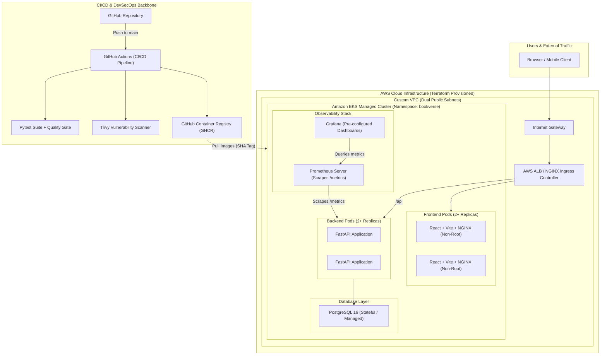

# BookVerse — Enterprise Bookstore & Library Platform
### DevOps Final Capstone Project 


**BookVerse** is a modern, enterprise-grade cloud-native bookstore and library management application designed and built to fulfill all 10 modules of the DevOps Final Capstone rubric. It demonstrates an end-to-end production lifecycle: full-stack application development, automated testing, containerization, GitOps CI/CD automation, DevSecOps security scanning, AWS Infrastructure as Code, Kubernetes/Helm deployment, and Prometheus/Grafana observability.

---

## 📑 Architecture Overview



---

## 🚀 Quick Start: Local Stack Execution (Docker Compose)

The entire three-tier stack (PostgreSQL, FastAPI Backend, and React Frontend) can be launched locally with a single command:

```bash
# Clone repository
git clone https://github.com/jaisheel15/Devops_Project.git
cd Devops_Project

# Launch stack
docker compose up --build -d
```

### Accessing Local Services
- **Web Application:** `http://localhost:3000`
- **FastAPI Documentation (Swagger UI):** `http://localhost:8000/docs`
- **Health Check Endpoint:** `http://localhost:8000/health`
- **Prometheus Metrics Endpoint:** `http://localhost:8000/metrics`
- **PostgreSQL Database:** `localhost:5432` (`bookverse_db`)

---

## 🧪 Running Automated Tests (Pytest)

The test suite uses an in-memory SQLite fixture with isolated database sessions, ensuring tests run rapidly without touching or modifying the production database.

```bash
cd backend

# Create virtual environment & install requirements
python3 -m venv .venv
source .venv/bin/activate
pip install -r requirements.txt

# Run all tests with verbose output
pytest -v
```

---

## 🛠️ Infrastructure as Code with Terraform (AWS)

The `terraform/` directory contains complete modular HCL code to provision a production-ready AWS environment:

```bash
cd terraform

# 1. Initialize Terraform & download AWS provider plugins
terraform init

# 2. Review the execution plan
cp terraform.tfvars.example terraform.tfvars
terraform plan

# 3. Apply infrastructure to AWS (creates VPC + EKS)
terraform apply -auto-approve

# 4. Clean teardown to prevent runaway AWS costs (Rubric M7 requirement)
terraform destroy -auto-approve
```

---

## ☸️ Kubernetes & Helm Deployment

Deploy BookVerse onto your Kubernetes cluster (e.g., EKS or Minikube) using the included Helm chart:

```bash
# 1. Create isolated namespace
kubectl apply -f k8s/namespace.yaml

# 2. Deploy or upgrade Helm chart
helm upgrade --install bookverse ./helm/bookverse -n bookverse

# 3. Verify deployment status
kubectl get pods -n bookverse
kubectl get svc -n bookverse
kubectl get ingress -n bookverse
```

---

## 📊 Observability (Prometheus & Grafana)

The application exports live metrics at `/metrics`. Prometheus and Grafana configurations are provided in `monitoring/`:

1. **Prometheus Scrape Configuration:** `monitoring/prometheus-values.yaml`
2. **Grafana Datasource & Dashboard Values:** `monitoring/grafana-values.yaml`
3. **Pre-built Dashboard Model:** `monitoring/bookverse-dashboard.json`

Key metrics monitored:
- **Request Rate (RPS):** `rate(http_requests_total[1m])`
- **Response Latency (p95):** `histogram_quantile(0.95, sum(rate(http_request_duration_seconds_bucket[1m])) by (le))`
- **Error Rates:** 4xx client errors and 5xx server exceptions.
- **Service Availability:** Scrape target `UP` state.

---

## 🔒 DevSecOps & Security Policy

Container images are scanned on every commit using Aqua Security Trivy (`.github/workflows/ci-cd.yml`):
- Non-root execution is strictly enforced (`USER appuser:10001` and `USER nginx:101`).
- Base images are pinned to minimal distributions (`python:3.11-slim` and `alpine`).
- Zero plaintext credentials are committed to version control; sample templates (`terraform.tfvars.example`) are used instead.

See [`docs/security_trivy_report.md`](docs/security_trivy_report.md) for full vulnerability scanning documentation.

---


